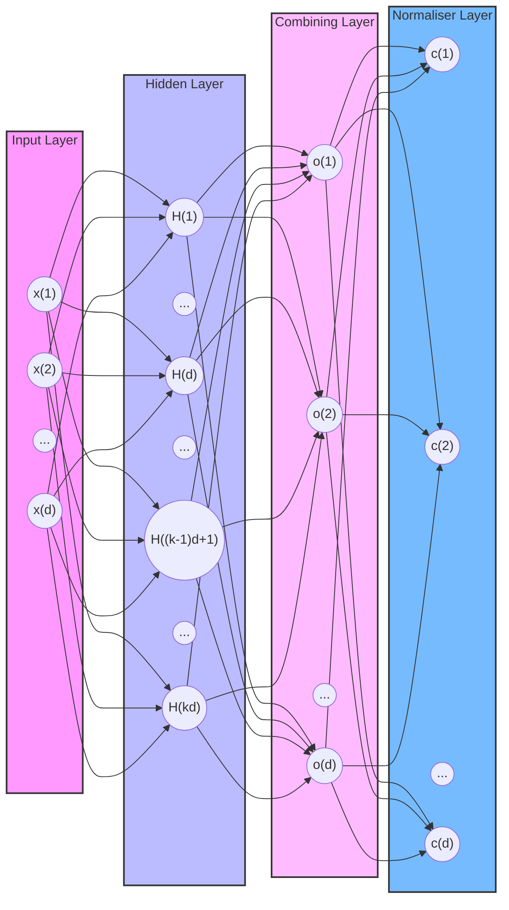
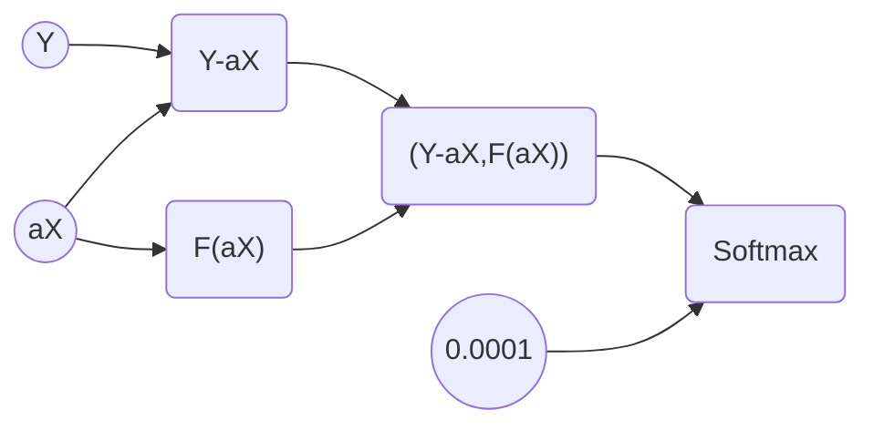

# One short separation theorem
This repository contains code to calculate data and form figures for the paper Bogdan Grechuk, Alexander N. Gorban, Evgeny Mirkes, and Ivan Tyukin. One short separation theorem

Please refer to this repository as on paper:
Bogdan Grechuk, Alexander N. Gorban, Evgeny M. Mirkes, and Ivan Y. Tyukin. One short separation theorem

## Compared models
In this study we compared the following models:
1. Theoretically the best one - shot. It is cardinality, calculated on the basis of Table 2 and formula (57) of the paper. There is no empirical testing for this indicator.
1. Universal boundary from Corollary 5.7 of paper. There is no empirical testing for this indicator.
1. Empirical one-shot model. We use directions defined in Table 2
1. Empirical Fisher separability evaluation
1. General linear separability
1. Linear neural network
1. Non-linear neural network
1. Universal separability direction defined in theorem 5.6 of the paper

## The best one-shot direction search
According to Table 2, you can find propositions that state the best functions $c(x)$ for each distribution. For new distribution, you should find the
$$\inf_{c\in R} E[\exp(c(Z-\alpha x))]$$
that define $c(x)$. For the **Cauchy, exponential, Gaussian, and Laplace** distributions, there are explicit formulae for $c(x)$ but for uniform in cube and Pareto distributions there is no such explicit formula. As a result, we used scripts `TheBestFormulaCube.m` and `TheBestFormulaPareto.m` correspondingly. These scripts or analogue ones, must be processed before data generation because tabulated data should be stored in the parameter `mu` of the generated data file.

It is important to emphasise that the normal vector for the hyperplane is calculated in two steps: firstly, transform each element as $c_i(x_i)$ and then normalise the vector $c$ to unit length.

## Data generation
To generate data, you should create a folder with the name of the distribution in the root folder of this software. Then specify the corresponding value in variable `dists` in script `DataGenerator.m`. Then you should run the script `DataGenerator.m`.

If you want to work with a new distribution, then you should add a new distribution name to the array `distribs` and add the corresponding fragment to the `switch case end` element in the script.

## Neural network training
In this study we used two types of neural networks (NN):
1. NN to find a hyperplane that separates one point from another in pairs
1. NN to reproduce the best direction defined as described in section "The best one-shot direction search".

### NN to reproduce the best one-shot direction
In this stage, we consider a shallow network with one hidden layer with the number of neurones equal to dimension $d$ multiplied by size, where size is one of $2, 3,\ldots,$ maxSize. The output layer contains d neurones because it should approximate the best one-shot direction. Training of such an NN is implemented in the script `TrainTheBestNN.m`.
In this diagram, $k$ is the size parameter of the hidden layer.
**Do not forget to create folder NNs in the main folder of the used distribution.**

### Separative NN find hyperplanу that separate one point from another in pairs

Structure of NN is presented in figure below.

The goal of Separative NN training is to train wrapped NN $F(\alpha X)$. This network can be linear (see script `TrainLinearNN.m`) or non-linear (see script `TrainNonLinearNN.m`).
**Do not forget to create folder NNs in the main folder of the used distribution.**

There are also some more files used for training of these networks:
1. `separativeFNN.m` contains the function to wrap NN
1. `extractionFromSNN.m` contains the function to extract previously wrapped NN
1. `subtractionLayer.m` contains the class that implements the subtractive layer

## Testing
There are two different testing protocols for testing. The first tests the separation of pairs and is a very coarse proxy of the required procedure, but is very quick.

The second testing protocol is used to directly test probability to be separable for sets with specified cardinality. It is absolutely clear that we cannot state that any 3 points will be separable. It is enough to get three points on one line. In this case, there is no hyperplane that can separate the middle point from two others in space of any dimension. On the other hand, the probability that three randomly selected (generated) points will be on one line is zero (simply because the line is set of measure zero). As a result, we can only estimate the probability of separability.

### Pair separation testing
A function to estimate the degree of pair separation is named `assessAcc` and can be found in file `assessAcc.m`.
This function is used in training all types of NNs: `TrainLinearNN.m`, `TrainNonLinearNN.m`, and `TrainTheBestNN.m`.

### Direct testing of separability
For 6 out of 8 models should be used script `TestModels.m`:
1. Empirical one-shot model
1. Empirical Fisher separability evaluation
1. Linear neural network
1. Non-linear neural network
1. NN simulated the best direction
1. Universal separability direction defined in theorem 5.6 of the paper

This testing has the following structure.

    For one distribution do
        For one dimension do
            Calculate theoretical separable cardinality K
            Do infinitely
                For each model from the list `models` create
                    count and set it to zero: C(i)=0
                10000 times do
                    Randomly select K points from the test set
                    For each model from the list `models` do
                        Test separability
                        If set is separable, put C(I)<=C(I)+1
                    end do
                end do
                Calculate the fraction of separable sets C/10000
                If all fractions are smaller than the
                    specified K then interrupt the infinite loop
                Increase K
            end do
            Write results to file
        end do
    end do

The test of general linear separability has the same structure as above but is run by script `TestGeneralLinSep.m`. This isolation of the general linear separability test is caused by a big difference in cardinality of separable tests: it is not necessary to test all other models if only general linear separability is successful in this cardinality.

Values for the theoretically best one-short model can be calculated by `theBest`.
The value of the universal boundary from Corollary 5.7 of paper can be calculated by the function `universalBoundary.m`. There is no empirical testing for this indicator.

The script `ReformatData.m` used all collected information to assemble data for each distribution into one file.

## Drawing figures
Figure 2 from the paper is produced by the script `FiguresForPaper.m`.

## Auxiliary functions
- `theBest` is the function to calculate the best one-shot separability direction. Used in the script `TrainTheBestNN.m` to calculate target vectors.
- `theoreticValues` is the function that calculates theoretical estimation of values for separability with probability p. Used in `TestModels.m` to estimate initial cardinality.
